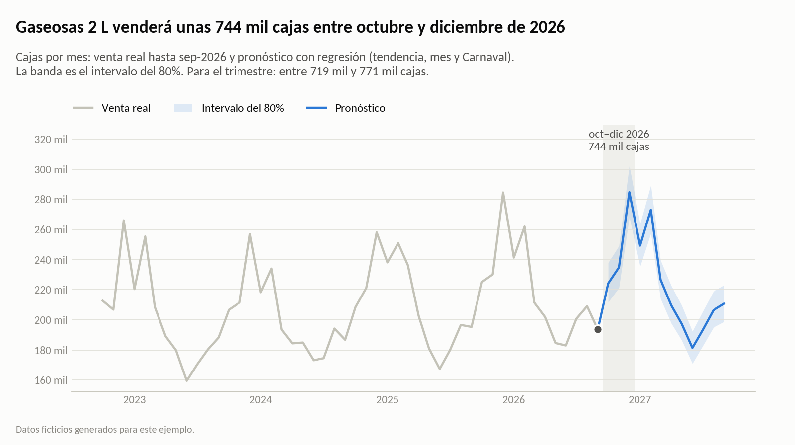
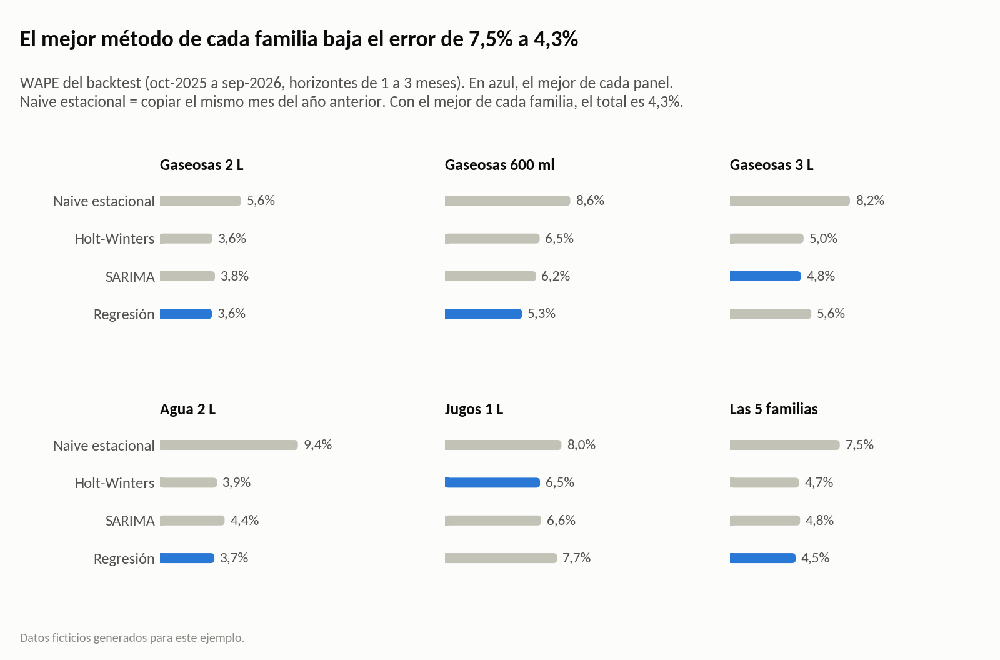
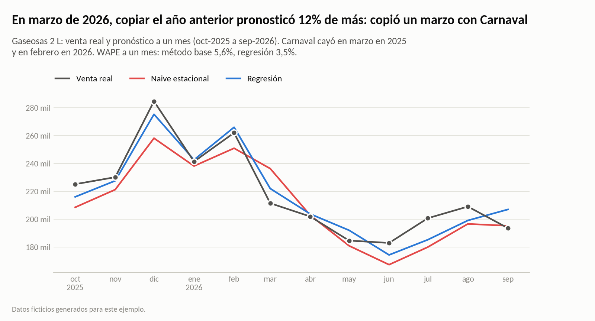
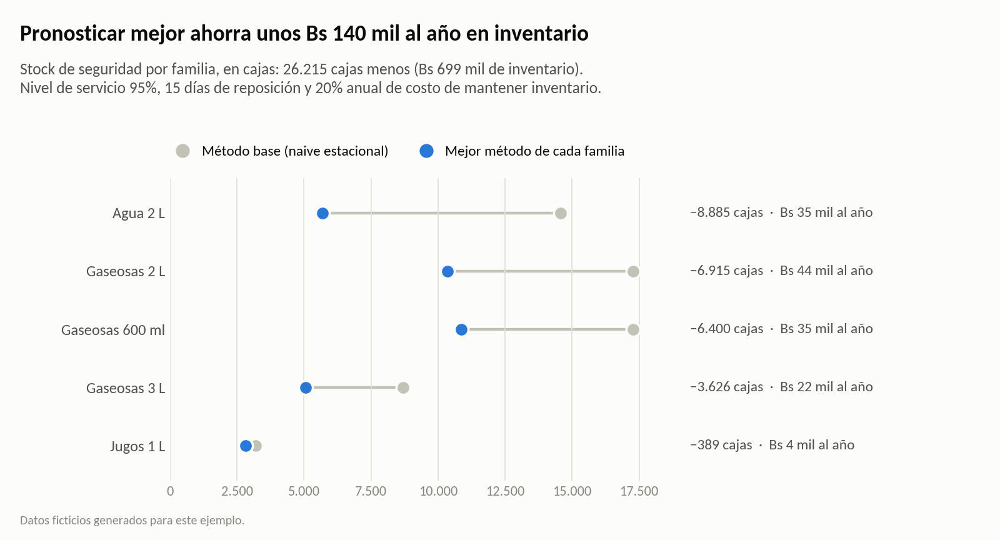
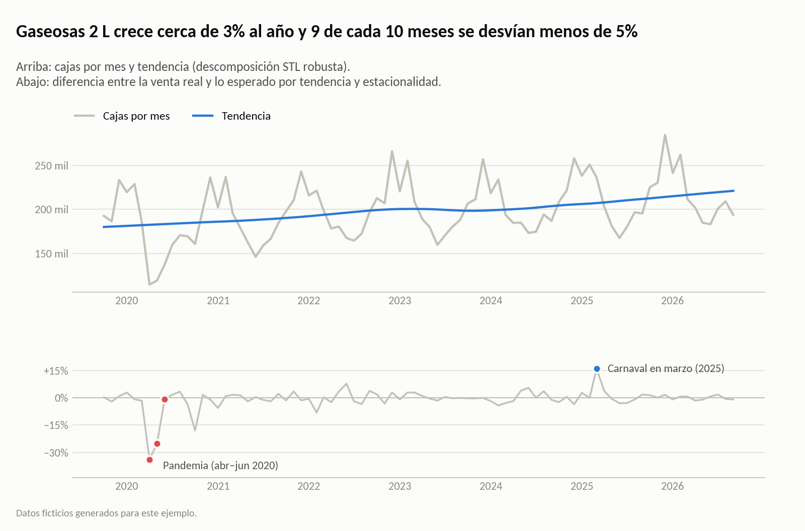
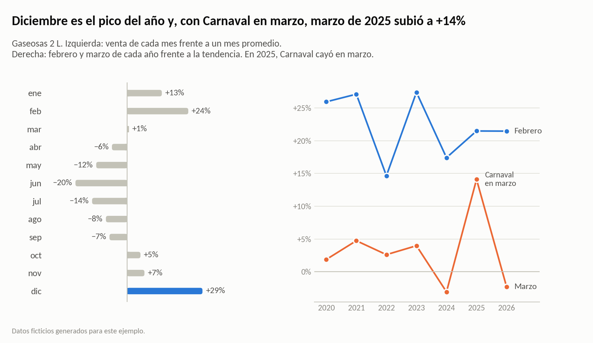

# ¿Cuántas cajas se van a vender el próximo trimestre y cuánto vale pronosticar mejor?

**Pronóstico de demanda con Python.** Este análisis compara cuatro métodos de pronóstico con un backtest y pronostica los próximos 12 meses con intervalos. Además, traduce el menor error a bolivianos de inventario.



> **Datos ficticios.** Son las ventas mensuales, en cajas, de cinco familias de productos de una embotelladora mediana de Santa Cruz de la Sierra, entre octubre de 2019 y septiembre de 2026. Se generan con `generar_datos.py` e incluyen tendencia, estacionalidad, Carnaval (con sus fechas reales), la caída de la pandemia, un aumento de precio y ruido. Los números sirven para mostrar el método; no describen a ninguna empresa real.

## Resultados

| Pregunta | Respuesta |
|---|---|
| ¿Cuántas cajas se venderán entre octubre y diciembre de 2026? | Unas **2,02 millones de cajas**, 3,2% más que en el mismo trimestre de 2025. Gaseosas 2 L, la familia principal, venderá unas **744 mil** (intervalo del 80%: entre 719 mil y 771 mil). |
| ¿Cuánto se equivoca copiar el año anterior? | Tuvo un error (WAPE) de **7,5%** en el último año. Se queda corto en lo que crece (sesgo de **−9,4%** en Agua 2 L) y arrastra el calendario: en marzo de 2026 pronosticó **12% de más** en Gaseosas 2 L porque copió un marzo con Carnaval. |
| ¿Qué método pronostica mejor? | Con el mejor método de cada familia, el error baja a **4,3%** (42% menos): regresión en Gaseosas 2 L, Gaseosas 600 ml y Agua 2 L; SARIMA en Gaseosas 3 L; Holt-Winters en Jugos 1 L. Los tres métodos estadísticos quedan cerca entre sí. |
| ¿Cuánto vale pronosticar mejor? | El stock de seguridad baja en unas **26.200 cajas**: cerca de **Bs 699 mil** menos de inventario y unos **Bs 140 mil al año** de costo de mantenerlo. Además, en diciembre de 2025, con el método base habrían faltado unas 14.900 cajas (cerca de **Bs 273 mil** de margen); con el mejor, unas 1.200. |
| ¿Qué hacer primero? | **Usar la regresión en Gaseosas 2 L, Gaseosas 600 ml y Agua 2 L antes de planificar diciembre.** Concentran el 81% del ahorro. Para 2027, planificar el pico de Carnaval en febrero: el sábado de Carnaval cae el 6 de febrero. |

## Cómo se hizo

1. **Datos.** `generar_datos.py` simula 84 meses de ventas de cinco familias. Cada familia tiene su propia tendencia, estacionalidad y efecto de Carnaval. También incluye la caída de abril a junio de 2020, un aumento de precio en julio de 2024 y ruido del mercado y de cada familia.
2. **Descomposición.** Una STL robusta sobre el logaritmo de las ventas separa tendencia, estacionalidad y residuo. Fuera de la pandemia, el 93% de los meses de Gaseosas 2 L queda a menos de 5% de lo esperado. El mayor desvío positivo es marzo de 2025, cuando Carnaval cayó en marzo.
3. **Limpieza.** Abril a junio de 2020 se reemplazan por lo esperado según la tendencia y la estacionalidad. Se hace dentro de cada ventana de entrenamiento, solo con los datos disponibles en ese momento.
4. **Cuatro métodos.**
   - Naive estacional, que copia el mismo mes del año anterior: es el método base.
   - Holt-Winters con tendencia amortiguada.
   - SARIMA (0,1,1)(0,1,1)<sub>12</sub>.
   - Una regresión con tendencia, un efecto por mes y Carnaval según su fecha real.
5. **Backtest de origen móvil.** Se usan 14 orígenes, de julio de 2025 a agosto de 2026, y horizontes de 1 a 3 meses. Cada horizonte se evalúa sobre los mismos 12 meses: en total, 720 pronósticos. Las métricas son WAPE y sesgo. Los avisos de statsmodels se cuentan en lugar de imprimirse, y hubo 0 en 210 ajustes.
6. **Pronóstico.** Cada familia se pronostica de octubre de 2026 a septiembre de 2027 con su mejor método. Los intervalos del 80% salen de 4.000 trayectorias simuladas; en el backtest cubrieron el 90% de los meses.
7. **Valor en plata.** Stock de seguridad = z × σ del error × √(tiempo de reposición). Los supuestos son conservadores y se pueden editar:
   - 95% de nivel de servicio.
   - 15 días de reposición.
   - Costo por caja igual al 60% del precio.
   - 20% anual de costo de mantener inventario.







| | |
|---|---|
|  |  |

## Estructura

```
├── analisis_pronostico.ipynb     análisis completo, con resultados y gráficos
├── generar_datos.py              genera los datos ficticios (semilla fija)
├── graficos.py                   estilo de los gráficos
├── requirements.txt
├── datos/
│   ├── ventas_mensuales.csv      una fila por mes y familia: cajas y precio promedio por caja
│   └── calendario_carnaval.csv   fechas reales de Carnaval de 2020 a 2027
├── resultados/
│   └── pronostico_proximos_12_meses.csv   pronóstico por familia y mes, con intervalo del 80%
└── img/                          gráficos del análisis
```

## Cómo correrlo

```bash
pip install -r requirements.txt
python generar_datos.py          # opcional: los datos ya están en datos/
jupyter notebook analisis_pronostico.ipynb
```

## Límites

- Con datos reales hay que repetir el backtest y validar con Finanzas el costo por caja y el costo de mantener inventario.
- Entre 2020 y 2026, Carnaval cayó en marzo una sola vez (2025), así que su efecto se estima con poca precisión.
- El σ del error sale de 12 pronósticos a un mes por familia. El ejemplo de diciembre es un solo mes. Las dos son estimaciones con margen.
- No incluye promociones, clima ni capacidad de planta, que con datos reales conviene agregar al modelo.

**Herramientas:** Python · pandas · statsmodels · SciPy · matplotlib

---

### English summary

This is a demand forecasting case study on a fictional bottling company in Santa Cruz, Bolivia. It uses synthetic monthly sales, in cases, for five product families from October 2019 to September 2026.
- It decomposes the series with robust STL, cleans the 2020 pandemic drop and models Carnival with its real calendar dates.
- A rolling-origin backtest (1 to 3 months ahead) compares seasonal naive, Holt-Winters, SARIMA and a calendar regression: the best method per family cuts WAPE from 7.5% to 4.3%.
- It forecasts October 2026 to September 2027 with 80% intervals: about 2.02 million cases next quarter.

Key finding: better forecasts cut safety stock by about 26,200 cases, around Bs 140,000 a year in holding costs.

---

Vicente Asbun · [LinkedIn](https://www.linkedin.com/in/vicente-antonio-asbun-karmy-30aa19164/)
